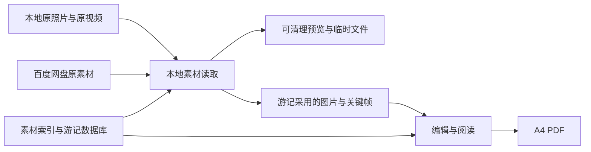

# 行迹：大量素材的存储方案与同类应用功能调研

日期：2026-10-12 · 状态：架构与产品建议，尚未实施存储迁移。

适用场景：自己和家人使用，主要在电脑上整理，素材来自本地与百度网盘，照片和文字比例灵活，默认导出可打印的 A4 游记。

调研依据：现有源码、产品需求，以及同类应用的官方功能页和帮助文档。产品功能是文档核验结果，未安装这些应用逐项实测；功能借鉴与优先级是针对本应用的建议。

## 1. 建议采用的方向

默认引用原始照片和视频，按需读取；保存轻量索引、游记内容和必要的图片衍生文件。需要独立保存时，允许用户选择复制原件或制作迁移包。

核心区别在于：原始素材可以在外部，已经写好的游记和采用的画面应当在本应用中可靠保留。视频不需要因为出现在一本游记里，就永久复制一份完整原片。

同一个素材库可以服务多本游记。一次引用、一次生成预览，多本游记共享；各本游记分别保存图注、裁切、排序和文字。

## 2. 当前实现与建议方案

| 项目 | 当前实现 | 建议方案 |
| --- | --- | --- |
| 本地导入 | 完整 File/Blob 写入浏览器 IndexedDB | 默认登记目录与文件位置，按需读取 |
| 百度网盘 | 下载完整文件，再写入 IndexedDB | 记录账号范围和文件 ID，预览与原片按需获取 |
| 素材衍生图 | 与原文件一起保存在浏览器中 | 区分可清理预览与游记已采用的保留画面 |
| 游记数据 | 当前浏览器及访问地址下的 IndexedDB | 本地资料库中的数据库与版本快照 |
| 跨游记复用 | 素材记录主要属于单本游记 | 共用素材索引，游记保存使用关系 |
| 备份 | 轻量 JSON、含素材 ZIP | 数据备份、阅读包、所用素材迁移包分别提供 |
| 大文件与大项目 | 单素材暂限 500 MB，完整备份暂限 1 GB | 本地引用不受当前导入缓冲方式限制；大包使用流式或文件夹导出 |

当前实现可核对 [素材导入](../src/media.ts)、[浏览器存储](../src/db.ts)、[备份](../src/backup.ts) 和 [网盘接口](../server/handlers.ts)。现有模型连接、图文编辑、A4 PDF 等能力继续使用，调整重点是素材存储与访问。

## 3. 数据分成四类

| 类别 | 保存什么 | 能否自动清理 |
| --- | --- | --- |
| 外部原素材 | 原来的本地文件；百度网盘里的原文件 | 本应用只维护引用 |
| 项目数据 | 正文、口述与确认事实、人物标签、素材关联、布局、打印设置、历史版本 | 不能作为缓存清理 |
| 保留的游记画面 | 已采用的打印图片、人工选择的视频帧、应用内录音 | 不能作为普通缓存清理 |
| 可重建缓存 | 浏览缩略图、未采用的候选帧、临时下载、可选播放代理 | 可以按上限和最近使用情况清理 |



### 本地资料库

保留“浏览器界面＋本地 Node 服务”的交付方式，由本地服务读取登记的素材目录，建议用 SQLite 保存索引与项目数据。后续可增加桌面安装包，方便选择目录和启动；这不是本轮存储调整的前置条件。

建议由用户选择一个可见的资料库目录，结构示意：

```text
行迹资料库/
  library.sqlite          素材索引、游记内容、使用关系、任务状态
  retained-media/         已采用的打印图、视频帧，跨游记共享
  recordings/             应用内产生或选择保留的录音
  versions/               项目版本快照
  cache/                  可重建缩略图、预览及临时下载
  managed-originals/      选择“复制原件”时使用
  exports/                PDF、阅读包与项目导出
```

原素材继续留在原目录。每个本地引用记录“素材根目录 ID＋相对路径”，更换电脑或磁盘后可批量重新指定根目录。普通浏览器的文件选择不能直接提供可靠的长期绝对路径引用，因此需要由本地服务增加目录登记与读取能力。

素材具有稳定内部 ID，路径变化不应导致图注、回忆和排版记录消失。本地目录访问限定在用户登记的目录范围内。

### 素材记录与游记使用记录分开

- 素材记录：来源、位置、大小、修改时间、拍摄时间、原图尺寸、视频时长、可用状态、校验信息。
- 游记使用记录：该素材属于哪本游记、哪一章，图注、裁切、排序、所选视频时间点和版面尺寸。
- 衍生文件记录：源素材版本、生成参数、文件位置、占用空间、是否被游记采用。

相同文件的不同路径、或同一文件在本地与网盘的两处位置，可以作为多个来源。确认它们内容相同后再合并，文件名相同不能作为合并依据。

## 4. 导入、读取与清理规则

### 本地素材

默认操作是“添加素材目录”：先登记文件并读取必要的元数据，缩略图和关键帧在后台生成。支持暂停、取消、断点继续和仅扫描新增/变化文件。

另提供“复制原件到资料库”，适合临时 U 盘素材、需要独立保存的旅行或无法长期访问的目录。复制模式显示预计体积，并在共用资料库中去重。

大视频先登记位置、大小和时长，避免导入时把完整视频读入浏览器内存。完整内容校验放到后台或疑似重复核验阶段，使用流式读取。快速指纹只用于寻找候选，不用于认定重复后删除文件。

### 百度网盘

登记账号范围、文件 ID、路径和元信息；按需获取可用的缩略图。选入游记的照片获取足够打印的画面，视频保留所选关键帧。

需要播放、抽帧或获取打印图片时，再获取原素材。优先使用接口允许的预览或分段读取；接口不具备这些能力时，允许临时下载完整文件，生成所需画面后释放临时原片。

不将临时下载链接作为永久素材标识。授权过期时保留游记内容与已采用画面，重新连接后恢复原素材访问。网盘文件不可用时显示状态，允许关联到本地同一文件。

**待验证：** 真实账号下的缩略图、原图尺寸、视频访问、分段请求、大文件下载、配额和授权要求。本次未用真实百度账号测试；官方文档页面未能通过检索工具正常读取，不依据第三方描述承诺这些接口能力。

### 缓存和保留画面

存储管理显示五项：项目数据、保留画面与录音、普通缓存、临时下载、托管原件。外部引用原件显示其体积，但不计入应用新增占用。

普通缓存建议初始上限 5 GB，可调整；这是产品建议值。临时大文件下载单独预检剩余空间和临时空间预算，不能悄悄绕过限制。播放转码按需开启，不默认给所有视频生成完整播放副本。

清理界面说明可释放的空间和影响。已采用画面从普通缓存转为保留文件；取消采用后也不能立即删除，要考虑其他游记和可恢复历史版本的引用。

图片按实际使用尺寸生成打印版本，目标约 300 DPI。裁切后重新计算有效分辨率，扩大版面时按需重建。压缩与缩小不会增加真实细节，模糊程度和像素数量分别提示。

删除缓存后，已经完成的游记仍能阅读和导出当前保存的 PDF 版式。重新选择视频时间点、放大图片或播放原片，则仍需要访问原素材。用户选择的关键帧时间点、图注和裁切参数始终保留。

### 空间示例

以下仅为估算示例，不是实际性能或容量测试：假设 10,000 张浏览缩略图平均 150 KB，1,000 张候选视频帧平均 200 KB，200 张采用的打印图平均 1.5 MB，合计约 2 GB；不包括录音、临时下载、托管原件和可选视频转码。

实际空间取决于画面尺寸、压缩质量和采用数量。收益主要来自不永久复制大量原视频，而非把全部照片压成很小的缩略图。

## 5. 缺失素材、备份与现有数据迁移

### 断链恢复

素材状态至少区分：原件可访问、原件暂不可访问但保留画面可用、需要重新授权、需要重新关联、内容发生变化。

移动整个素材目录时重新指定根目录；移动或改名的单个文件通过大小、时间和内容校验寻找候选，再确认关联。离线硬盘和断网是暂不可用，不自动删除素材记录或游记中的内容。

原件发生变化时提示更新，保留当前游记采用的画面及版本，避免静默替换成另一个文件。

### 导出与备份分开

| 类型 | 内容 | 使用场景 |
| --- | --- | --- |
| 项目数据备份 | 游记内容、布局、来源信息、版本及自建录音；可选择包含保留画面 | 继续编辑与定期备份；原件需重新关联 |
| 阅读包 | PDF，后续可增加图文阅读页及采用的画面 | 交给家人阅读，通常不需要完整原视频 |
| 所用素材迁移包 | 项目数据、采用画面、录音、这本游记实际采用的原素材 | 换电脑、独立存档；导出前列出缺失项 |
| 素材库全量备份 | 用户明确选择的全部原素材和项目数据 | 单独安排大容量存储与备份，不作为每本游记的默认导出 |

迁移包须说明未采用素材是否随包，以及视频是包含原片、所选片段还是只有关键帧。只有打包范围内的原件齐全，才能标为“可独立恢复”。模型密钥、网盘令牌不进入备份。

大项目在本地服务中流式处理，提供文件夹导出；选用压缩包时验证大文件格式与恢复支持，不能沿用当前浏览器内存生成整包和 1 GB 上限。数据库备份须取得一致快照，并校验清单与媒体文件完整性。

### 旧 IndexedDB 项目的迁移

旧版本没有保存可持续访问的原始文件路径，不能自动把全部副本改成有效引用。

1. 读取旧项目并写入本地资料库，保持 ID 或建立明确映射，校验内容、布局与素材。
2. 对还没有外部来源的原件，先写入托管原件目录，确保项目可继续使用。
3. 用户指定原素材目录或重新连接网盘，核验内容后建立外部引用。
4. 通过清理入口列出已经核验的重复副本和可释放空间，再释放旧副本。
5. 显示无法关联的项目并保留其托管原件。迁移中断可以继续，重复执行不会复制多份。

旧视频指纹主要由名称、大小和修改时间组成，重新关联并释放副本前需要更可靠的内容核验。迁移默认保留旧数据，确认新资料库和备份可恢复后再清理。

## 6. 同类应用里值得借鉴的功能

下表的“已核验功能”来自官方页面；“借鉴方式”是本应用的建议，不表示相关功能已经实现，也不表示我们需要采用相同存储或商业模式。

| 应用类型／产品 | 已核验功能与来源 | 对本应用的借鉴方式 |
| --- | --- | --- |
| 旅行记录：Polarsteps | 以地点步骤组织文字、照片和视频；支持自动旅行轨迹。[步骤说明](https://support.polarsteps.com/hc/en-us/articles/23760478173586-What-are-steps-and-how-do-I-add-or-edit-them)、[旅行追踪](https://www.polarsteps.com/travel-tracker) | 电脑整理时按“日期＋地点＋事件”组织素材，可手动修正；照片点位作为行程概览，精确路线需要轨迹文件 |
| 照片书：Journi | 根据拍摄时间排序、自动生成版式、允许调整照片和布局；可添加日期标题和地图，依赖正确元数据。[排序与布局](https://support.journiapp.com/hc/en-us/articles/31859161742493-How-to-arrange-photos-and-change-page-layouts-in-my-Photo-Book)、[照片书设置](https://support.journiapp.com/hc/en-us/articles/5449295861661-Photo-Book-Settings) | 增加目标页数、每段精选建议和多版式候选；信息缺失时允许补充，保护人工锁定内容 |
| 日记：Day One | 主题写作提示帮助回忆；共享日记允许成员补充条目、评论及回应；支持录音和特定平台上的转写。[写作提示](https://dayoneapp.com/features/prompt-packs/)、[共享日记](https://dayoneapp.com/guides/shared-journals/shared-journals/)、[录音](https://dayoneapp.com/guides/tips-and-tutorials/audio-recording/) | 用中文问题引导照片口述，记录不同家人的讲述者；成员补充与最终正文分开，由主编选择采用 |
| 影像管理：Immich | 外部素材库可以登记已有目录并设为只读；支持自然语言及多条件搜索、视觉相似查重。[外部素材库](https://docs.immich.app/features/libraries/)、[搜索](https://docs.immich.app/features/searching/)、[查重](https://docs.immich.app/features/duplicates-utility/) | 引用原件、保留稳定关联、跨游记检索；中文语义检索选用适合中文的模型并测试，智能索引按需建立 |
| 桌面影像管理：digiKam | 多素材目录、相似查找、评级与标签、人物及地图检索、并排比较图片。[功能列表](https://www.digikam.org/about/features/)、[相似查找](https://docs.digikam.org/en/left_sidebar/similarity_view.html) | 增加连拍／相似照片组、并排放大、喜欢／候选／不用等标记；相似照片保留与否由用户决定 |
| 照片书与印刷：CEWE | 视频可作为静态画面与二维码排进照片书；打印质量指示会检查图片在使用尺寸下的分辨率。[视频入书](https://www.cewe.co.uk/tutorials/photo-books/adding-video.html)、[分辨率指示](https://www.cewe.co.uk/service/faqs.html) | 加强视频选帧、连续画面与 A4 打印检查；二维码另依赖长期可访问的视频链接 |
| 旅行记录：FindPenguins | 旅行照片书包含故事、地图、照片、统计，并可选择收录朋友评论。[官方介绍](https://findpenguins.com/) | 增加旅程概览页、家人留言选编、年度旅行合辑；统计来源与估算范围清楚显示 |

### 调研中的几个实际边界

Polarsteps 的帮助文档说明，上传的视频画面不会自动进入纸质旅行书，需要另外保存静帧并作为照片加入。这让“视频选帧直接进入游记”成为我们值得做好的功能。[官方说明](https://support.polarsteps.com/hc/en-us/articles/26684971392914-Will-videos-appear-in-my-Travel-Book)

CEWE 的分辨率指示主要检查使用尺寸与像素数量，不代表能判断对焦或拍摄抖动。我们的“打印像素够不够”和“画面是否模糊”应分别呈现。[官方 FAQ](https://www.cewe.co.uk/service/faqs.html)

Immich 外部素材库当前文档提示，移动文件可能使应用内添加的部分信息丢失。我们应把稳定素材 ID 与路径分开，重新关联时保留正文、图注和使用关系。这是针对本应用的改进建议。[官方说明](https://docs.immich.app/features/libraries/)

Day One 的提示包页面说明初始内容以英文提供，录音转写也存在平台与录音来源限制。本应用应设计中文家庭旅行提示，继续保留自选语音模型和导入录音的路径。[提示包说明](https://dayoneapp.com/features/prompt-packs/)、[录音说明](https://dayoneapp.com/guides/tips-and-tutorials/audio-recording/)

## 7. 功能清单与优先级

优先级定义：P0 是大量素材使用的基础；P1 是紧接着提升整理效率的功能；P2 是家庭体验与内容表达扩展；P3 是使用反馈明确后再投入。现状以本次阅读的源码及已有验证记录为准。

| 功能 | 现状 | 优先级 | 建议行为／依赖 |
| --- | --- | --- | --- |
| 引用原件、共用素材库 | 未实现 | P0 | 本地目录登记、稳定 ID、跨游记复用、可选复制 |
| 缓存占用与清理 | 未实现 | P0 | 分类体积、可调上限、保留画面保护、临时下载预算 |
| 批量重新关联、旧数据迁移 | 有单素材关联及照片匹配基础 | P0 | 根目录重定位、可靠核验、保留历史使用关系 |
| 持久历史版本、适合大项目的备份 | 自动保存和会话撤销已实现；现有完整备份受限 | P0 | 本地版本、数据库一致快照、流式／目录备份、恢复验证 |
| 按天／地点／事件整理 | 已读取照片时间定位，并用于章节生成 | P1 | 可视分组、时区／拍摄时间批量修正、缺信息分组 |
| 精选助手与并排选片 | 有照片内容去重、手动选片 | P1 | 连拍／近似组、清晰度候选、并排放大、用户确认 |
| 看照片引导口述 | 录音、转写、关联与确认已实现 | P1 | 提问“当时在哪里、谁在一起、最难忘什么”，回答后生成内容 |
| 视频连续画面 | 已能选择单张关键帧 | P1 | 候选帧带时间点、人工选多帧、3–6 帧故事板版式 |
| 目标页数与章节密度 | 已有三种模板与图文编辑 | P1 | 目标页数作为指导，按章节调整，超量时推荐精选或拆分，不丢内容 |
| 家人分角色补充回忆 | 未实现 | P2 | 记录讲述者、留言、采用状态；跨设备访问与身份能力是前提 |
| 行程概览、地图页 | 有照片 GPS 读取基础 | P2 | 地点可手动修正，GPX 可选；点位连线不能标为实际行走路线 |
| 人物与中文自然语言找图 | 未实现 | P2 | 先支持手工人物标签；智能识别与语义索引按需开启、验证中文效果 |
| 家庭阅读模式、年度合辑 | PDF 阅读已可用；未提供专门阅读模式 | P2 | 只读图文、大字版、按人物或年份汇编，多本共享素材 |
| 视频二维码、网页分享 | 未实现 | P3 | 稳定链接、可见范围、可维护的托管；本机地址和临时下载链接不用于纸质二维码 |

“精选”是推荐与隐藏候选，默认不删除原文件；“从游记移除”只改变使用关系。AI需要逐项调用时显示预计处理数量，先处理选定素材与候选，避免导入整个素材库就向云端模型发送大量照片或视频。

## 8. 推荐的实施顺序与验收目标

### 第一轮：先支持长期存放和大素材量

实现本地资料库、引用式导入、共用素材索引、预览队列、保留画面、存储管理、批量重新关联、旧项目迁移和可靠备份。百度网盘先做真实权限验证，再接入相同的来源与状态模型。

验收目标，尚未完成性能测试：

- 登记含 10,000 张照片与 1,000 个视频的目录，不产生相同体积的原件副本；在元数据扫描进行时也能整理已经可用的素材。
- 大于 10 GB 的本地视频可被引用和按需处理，不整体装入浏览器内存；兼容格式的范围单独验证。
- 同一素材用于两本游记，不重复永久保存原件；清理一本游记不破坏另一本文档的画面。
- 导入／扫描中断后可继续，变化扫描不重复处理所有未变化文件。
- 移动素材根目录后批量恢复关联，图注、正文、裁切、视频时间点与历史记录完整。
- 外部硬盘离线或网盘授权失效时，仍能阅读和导出已保存版式；需要原片的操作清楚提示重新连接。
- 清理普通缓存不影响已采用的画面、自建录音与项目数据。
- 旧项目迁移失败不破坏旧数据，重新执行不会出现多份重复项目或素材。
- 备份和恢复处理大批素材时没有静默截断，文件数量、内容校验与恢复后的布局一致。

### 第二轮：缩短从素材到游记的整理时间

优先组合“按天与事件分组＋并排精选＋照片口述引导＋视频多帧版式”。随后增加目标页数、章节版本对比与更直观的打印质量提示。

如果口述信息不完整，明确列出待确认项。照片识别出的场景不能替代家人的真实感受；多位讲述者的不同回忆允许并存，不自动改写成单一确定事实。

### 第三轮：家庭阅读与回忆积累

根据实际使用推进家人补充、行程地图、人物检索、年度合辑。二维码与跨设备分享单独设计稳定访问方式；家庭协作不要求多人同时修改排版。

## 9. 下一轮开发前需要验证的细节

| 事项 | 验证内容 |
| --- | --- |
| 使用电脑 | 操作系统、磁盘与外接盘路径、中文文件名、常见手机图片和视频编码 |
| 百度网盘 | 真实授权与可用接口、预览清晰度、视频抽帧路径、限额、大文件与连接过期恢复 |
| 缓存及打印图 | A4 裁切后的有效分辨率、实际体积、保留策略、缓存上限和离线导出效果 |
| 中文智能整理 | 相似组的误判、中文搜索模型、人物候选、不同家庭成员口述的事实关联 |
| 大规模性能 | 扫描耗时、后台任务占用、界面响应、磁盘峰值、暂停与恢复 |
| 迁移与备份 | 旧 IndexedDB 数据访问、新目录落盘核验、根目录重新关联、恢复完整性 |

建议下一次开发先完成第一轮，并以一份真实的代表性旅行素材验证，再决定第二轮中各项功能的细分顺序。
